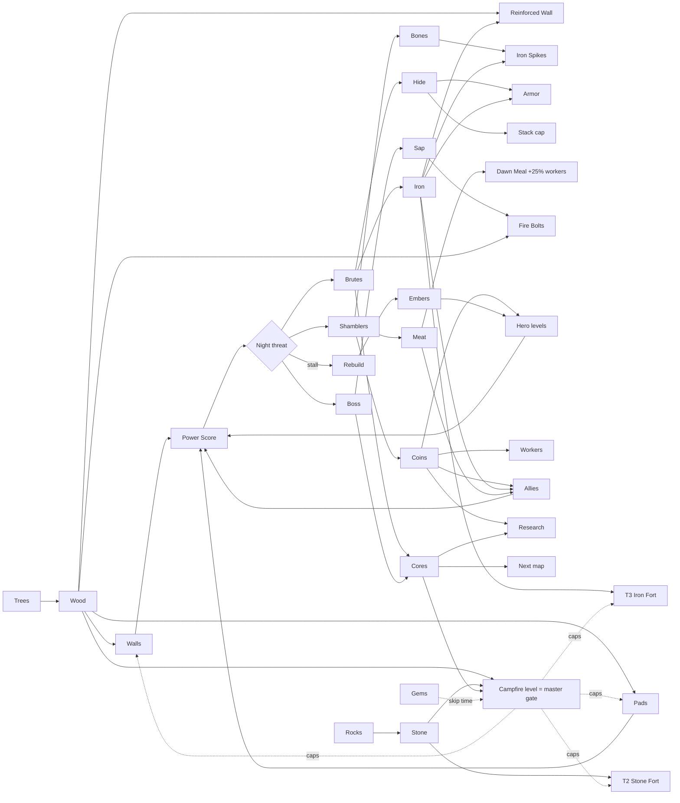

# Fort Idle: endless progression, adaptive enemies, and a multi-supply economy

2026-10-27 (Asia/Shanghai). This is a design proposal and nothing in it is built yet. The numbers start from the current values in GDD.md and MAP1_SPEC.md. To get the night table below, run `python3 sim_progression.py`; add `--nights 80` or `--embers N` to test prestige.

---

## 1. What proven games do (findings)

### A. Unlimited levels / replay forever
| Game | Mechanism | Source |
|---|---|---|
| AdVenture Capitalist and the idle genre | The cost of the next item is `base × rate^owned`, with rates usually between 1.07 and 1.15. Production grows linearly with the number owned, and ×2 milestone multipliers at 25 and 50 owned keep each purchase worth making. Prestige "slides the curve" so a new run moves faster. | [Kongregate: Math of Idle Games I](https://www.kongregate.com/en/pages/the-math-of-idle-games-part-i) |
| Realm Grinder, AdCap, Cookie Clicker, Egg Inc. | Prestige currency grows as a root of lifetime earnings. Under AdCap's square root, earning 4× as much doubles your prestige. Cookie Clicker uses a cube root, so you need about 8×. Diminishing returns are deliberate, so each run ends naturally and you then reset. | [Kongregate: Math of Idle Games III](https://www.kongregate.com/en/pages/the-math-of-idle-games-part-iii) |
| Clicker Heroes | Zone HP is `10×(L−1+1.55^(L−1))`, then ×1.145 per zone. A boss comes every 5 zones with 10× HP and a 30 s timer, and biomes rotate every 10 zones, so levels never run out. | [Clicker Heroes wiki: Formulas](https://clickerheroes.fandom.com/wiki/Formulas)* |
| Brotato endless | From wave 21 it reuses the scripts for waves 11–20 and multiplies them by a factor that grows quadratically: `f = n(n+1)/200 × (2+max(0,(w−35)·0.2))`. Enemy HP is ×(1+2.25f), damage ×(1+f), and shop prices ×(1+f/5). The curve is designed so every endless run eventually ends. | [teemo.dev: Brotato scaling & endless](https://teemo.dev/game-design/brotato/systems/enemy-scaling-danger-and-endless/) |
| Bloons TD6 freeplay | From round 81, HP grows by a piecewise rate per round: +2%, then +5%, +15% and +35%, up to +500%. Cash per pop drops to 50%, 20%, 10% and finally 2% at round 141+, and rounds past 140 are randomly generated. | [Bloons Wiki: Freeplay](https://www.bloonswiki.com/Freeplay) |
| My Perfect Hotel (closest to our genre) | Each hotel reaches a max level of 8, 11 or 13 and then the next one opens. Every hotel has its own cash, and tokens persist across hotels. Players go back to old hotels to farm. The reviewer felt the later hotels were repetitive, so we need fresh twists, not just bigger numbers. | [arpubrothers deconstruction](https://arpubrothers.com/blog/my-perfect-hotel-arcade-idle-deconstruction/) |

### B. Enemies that adapt to you
| Game | Mechanism | Source |
|---|---|---|
| Vampire Survivors (secondary source) | Spawn HP is `base × (1 + time + curse) × (1 + k × player level)`, where k is small for fodder and steep for bosses. Curse is an opt-in setting: more difficulty for more XP and gold. Endless cycles add +100% HP, +50% spawns and +25% damage. Gold keeps after a failed run. | [teemo.dev: VS pacing](https://teemo.dev/game-design/vampire-survivors/systems/difficulty-pacing-and-tension-management/) |
| Left 4 Dead AI Director | It adapts **pacing**, not stats. The Director tracks an "intensity" value for the players and cycles through Build-up, Peak (3–5 s), Fade, then Relax (30–45 s). | [Valve: AI Systems of L4D (PDF)](https://cdn.fastly.steamstatic.com/apps/valve/2009/ai_systems_of_l4d_mike_booth.pdf) |
| Kingdom Two Crowns | A Blood Moon arrives about 2 days before each season change, and from year 3 there are two per season. Each moon adds new enemy types (1st greedlings only, 3rd adds floaters, 5th adds breeders and crown stealers), and a calmer day follows. | [Kingdom wiki: Blood Moon](https://kingdomthegame.fandom.com/wiki/Blood_Moon)* |
| Brotato danger levels | Difficulty is opt-in: Danger multipliers are ×1.12, ×1.26 and ×1.40, plus +60% at Nightmare. Elites have reduced HP before wave 12. | teemo.dev link above |
| Genre convention (no single source) | The usual way to generate enemies from a **threat budget** is to set a point budget per wave, buy enemies from a cost table, and cap the enemy count while raising toughness instead. If difficulty follows player power too closely, upgrades feel pointless; Oblivion's level-scaling is the classic complaint. That's why the rubber band below is clamped and weak. | — |

### C. Multi-supply economy
| Game | Mechanism | Source |
|---|---|---|
| Whiteout Survival | The Furnace caps every other building, and resources unlock by tier: wood at Lv2, coal at Lv4, iron at Lv6 and meat at Lv11. Costs climb roughly exponentially (Lv10 needs about 460K wood, Lv20 about 21M), with Fire Crystal levels after Lv30. Low-tier troops cost meat and wood, and higher tiers add iron and coal. | [WOS Forge: Furnace](https://wiki.wosforge.org/wiki/Furnace) |
| Last War / Whiteout / Kingshot | The pattern is 3–5 resources, one master gate building, time gates you can skip with speedups, and power that feeds a ladder. A sink/faucet sim shows the balance matters: gathering 400 against a 550 sink keeps stock near zero, while gathering 700 inflates it to 18,400. | [Pavel Ignatov: Last War teardown](https://pavelignatov.com/blog/last-war-teardown) |
| Clash of Clans | Each currency has its own job. Gold pays for defenses and walls, Elixir for army and research, and Dark Elixir for heroes. | [CoC wiki: Resource Buildings](https://clashofclans.fandom.com/wiki/Resource_Buildings/Home_Village)* |
| Machinations (economy theory) | An economy is built from sources, drains, converters and traders. Bottlenecks come from limited rates, pool caps and queues. | [Machinations: converters & traders](https://machinations.gitbook.io/docs/converters-and-traders) |

\*Fandom pages opened normally with the fetch tool during research. Fandom blocks scripted curl with a 403, which is a bot block, not a dead link. All the other links returned 200 on 2026-10-27.

---

## 2. Fort Idle proposal

### 2.1 Structure of an endless run
- **Maps 1–5 (nights 1–25)** are authored. Each map has 5 nights and a boss on night 5, as now. Each biome's base threat is **×1.6** the previous one (the GDD says ×1.5; 1.6 keeps up with the hero, who carries over between maps). Each map's fort is rebuilt and has its own currency, as in My Perfect Hotel. Hero, allies, workers (1 veteran) and research carry over.
- **Endless (night 26 onward)** reuses the map 1–5 scripts in a rotating biome order, so the visuals cycle like Clicker Heroes biomes:
  - Threat grows **×1.10 per night**. That is exponential, while the player's power grows roughly polynomially, so every run eventually stalls, as in Brotato.
  - Night pattern: a boss every 5th night, a **Blood Moon every 10th** (×1.5 threat, ×2 loot, a new enemy type, then a **rest night at ×0.7**), following Kingdom Two Crowns.
  - When you stall, you **Rebuild** (prestige, §2.6). In the sim, the first run ends on night 35. A Rebuild with 40 Embers reaches night 45, and 120 Embers reaches night 55, so each run goes further.
- **Weekly twist** (stops later maps feeling the same, the My Perfect Hotel problem): one random modifier per week, e.g. "Brutes split on death", "Night is 60 s but double loot", or "No turrets, allies ×2". The Horde Rush leaderboard from the GDD uses the same seed for every player.

### 2.2 Cost curve (everything you buy)
```
cost(L)   = base × g^L
bulk(n)   = base × g^L × (g^n − 1)/(g − 1)            # "Buy ×10" button
maxBuy    = floor( log_g( money×(g−1)/(base×g^L) + 1 ) )
```
| Track | Currency | base | g | Effect per level |
|---|---|---|---|---|
| Hero DPS / stack / speed | coins | 40 | 1.15 | +10% hero DPS; **×1.5 milestone every 10 levels** (AdCap-style 25/50 bumps) |
| Defense step beyond Lv3 ("stars") | wood → stone → iron by tier | 60 | 1.12 | +15 DPS or +250 HP |
| Allies | coins + iron + meat | 150 | 1.18 | +1 ally (12 DPS × 1.25^map) |
| Workers | coins | 200 | 1.5 | +1 (4 per map, as now) |
| Research | coins + cores | 1 core ×2 per tier | 2.0 | permanent % |

### 2.3 Power Score (PS): how strong the player is
```
DPS_total = hero(40 × (1+0.1·heroLv) × weaponTier) + Σ defenses DPS + Σ allies DPS     (× enchant/ember mult)
PS        = η × DPS_total × NightSeconds × sqrt(1 + FortHP/5000)          η = 0.5, NightSeconds = 45
```
PS answers "how much enemy HP can my fort kill in one night". Walls count with diminishing returns: they buy time but don't kill anything. The game calculates PS at dusk from live components, so the same code works for the HUD's "Fort Power" number.

### 2.4 Night threat budget (adaptive, clamped)
```
B_base(n)   = MAP1_BUDGET[i] × 1.6^(map−1)                    n ≤ 25   (MAP1_BUDGET = 720,1200,2400,3600,4500)
            = 4500 × 1.6^4 × 1.10^(n−25) × kindMult             n > 25   (blood 1.5, rest 0.7)
expectedPS  = B_base / targetRatio[kind]                        normal 0.75 · boss 0.95 · blood 1.0 · rest 0.55
rubberBand  = clamp( (PS / expectedPS)^0.25 , 0.85 , 1.20 )     (off for nights 1–3: authored FTUE)
Threat(n)   = B_base × rubberBand × (0.8 if lost twice in a row)  ← existing GDD valve
```
- **Why α = 0.25 and the clamps:** a player who over-levels sees at most +20% more enemies, so they still feel stronger. A player who falls behind gets at most −15% (plus the −20% loss valve), so they aren't stuck for long.
- **Loot scales with threat:** coins = threat ÷ 20 (shambler 3, brute 30). A harder night therefore pays more, the same trade as Vampire Survivors' Curse.
- **Optional "Curse" slider** (opt-in, unlocks at map 3): +10–50% threat for +10–50% loot and Embers.
- **Pacing:** within a night, spawns follow L4D-style waves: build-up (60% of the budget), peak (30%, with the boss or elites), then a 10% straggler fade. Don't spawn a flat stream.

### 2.5 Turning the budget into enemies
Spend the budget in this order: **boss → brutes → elites → shamblers**.
- **Boss HP** = ⅔ × budget on boss nights (Treant: 3000 of 4500 ✔).
- **Brute share** = min(45%, 10% + 3% × (n − 3)) of what remains, starting night 3, at 600 HP each.
- **Shamblers** = the remainder ÷ 60.
- **Count cap 150**: past the cap, keep the count and raise HP (HPx in the table). Every ×2 HP above base promotes the enemy to the next visual tier: Shambler → Ghoul → Wight. Tougher-looking enemies replace a bigger crowd.
- **Elite chance** = min(25%, 2% × (n − 5)) from night 6. Each elite gets one affix that **counters a player choice**, which makes the build matter. Armored (+50% HP; Lightning ignores it), Swift (+40% speed; walls matter), Burning (immune to Fire; use Frost), Shielded (blocks the first 3 hits; turrets are better), Splitter (use cleave or Fire AoE), Regen (needs burst damage or Poison).
- **Boss cadence:** a boss every 5 nights; in endless, the boss rotates between the 5 biome bosses with a +1 affix per cycle. A Blood Moon every 10 nights, each one adding a new enemy type: night 30 Bomber, 40 Thief (steals stack), 50 Siege (targets walls), as in Kingdom.

### 2.6 "Rebuild" prestige with a permanent currency: **Embers**
```
Embers_total = floor( 10 × sqrt( lifetime threat cleared / 10,000 ) )     # AdCap/Realm Grinder style sqrt
Gain on Rebuild = Embers_total − Embers_already_claimed
Each Ember = +3% DPS and +3% income (all sources), forever
```
- Rebuild resets the map, fort, workers, coins and per-map currencies. You keep the hero's visual tier, research, gems, cosmetics and Embers.
- Rebuild is offered when you've lost 3 times on one night or chosen to stop. The button shows "Rebuild now: +X Embers (+Y% power)".
- **Ember shop** (a second sink, so Embers don't only add flat %): start with 2 workers (25 E), keep 1 turret (40 E), auto-chop (60 E), a 6th weapon slot (100 E), and Curse levels (each 50 E).
- Sim check: run 1 ends at night 35 with about 78 Embers, which takes the next run to roughly night 45. A sqrt curve means you need 4× the lifetime clears to double Embers, so returns slow down naturally.

### 2.7 Soft caps (so numbers don't explode)
- **Stack cap** goes 20/40/60/90/120, then +10 per research level with ÷(1 + lvl/10) diminishing returns.
- **Stacking % bonuses:** add bonuses from the same source family, multiply across families (hero, enchant, ember, research). Inside a family use `eff = raw / (1 + raw/cap)` with cap = 300%.
- **Endless cash decay** (Bloons): from night 41, coins per kill drop to 50% (41–50), then 25% (51–60), then 10% (61+). Cores and Embers don't decay, so late endless is about Embers rather than coins.
- **Offline earnings:** 2 h cap, extendable to 8 h with research or the pass (genre convention).

---

## 3. The economy: every supply has a job

| Supply | Source (faucet) | Sinks | Role | Gates | Converts into |
|---|---|---|---|---|---|
| **Wood (planks)** | Trees (hero 3/hit, workers) | Walls, gates, pads, T1 builds, defense stars | **Primary**, always flowing | T1 wood fort | + Iron → Reinforced Wall; + Sap → Fire Bolts |
| **Stone** | Rocks (after N1), workers | T2 walls (1100 HP), towers Lv2+ | **Tier material** | **T2 stone fort** | + Wood → Stone Wall / Tower Lv2 |
| **Iron** | Brute drops; Mine (map 2+) | T3 defenses, turret Lv3, allies, weapons | **Bottleneck**: scarce, decides upgrade order | **T3 iron fort**, Musketeer/Knight | + Hide → Armor; + Bones → Iron Spikes |
| **Coins** | Every kill (HP ÷ 20), dawn bonus | Hero levels, workers, allies, research | **Universal soft currency** | — | Spending outlet for everything |
| **Meat** | Shamblers ~30%, boars by day | Dawn Meal (+25% worker speed), heals | **Consumable buff** that spends itself | — | Meat → Meal (campfire converter) |
| **Bones** | Shamblers ~50% | Bone Spikes, Necro enchant | **Trap material** | Spikes Lv2 | Bones + Iron → Iron Spikes |
| **Hide** | Brutes 2–3 | Backpack (stack cap), armor | **Carry/defense** | Stack 60+ | Hide + Iron → Armor |
| **Monster Cores** | 1 per brute, 5 per boss | Research, map gates (map 2 gate) | **Progression bottleneck**: one per map gate | **New maps, research tiers** | Cores → Research; surplus → Ember bonus |
| **Treant Sap / biome essence** | Boss only (1 per biome) | Fire bolts, enchant tier-ups | **Rare premium-like** (earned, not bought) | Enchant Lv2+ | Sap + Wood → Fire Bolts |
| **Gems** | Daily, pass, IAP, Blood Moon | Speedups, skins, extra slot | **Premium (hard)** | Never a hard gate | Gems ↔ time (skip) |
| **Embers** | Rebuild only | Ember shop, +3%/Ember | **Meta / prestige** | Endless depth | — |

Rules (Last War sink/faucet lesson plus Clash of Clans "each currency has a job"):
1. **One master gate:** the **Campfire level** caps every defense's level, like Whiteout's Furnace. The Campfire upgrade needs wood + the tier material + cores.
2. **Every supply has at least 2 sinks**, and no resource is left behind: excess Meat, Bones and Hide sell for coins at 25% at the Trader.
3. **Target spend ratio of 80–110% of income per day** at the intended pace. Under 70%, stock piles up and choices disappear; above 110%, the player feels stuck. The sim's greedy buyer is the reference.
4. **Exactly one bottleneck per map:** Map 1 wood, Map 2 stone, Map 3 iron, Map 4 hide/cores, Map 5 sap. The game always tells you "what to get next".
5. **The HUD hint shows the next goal and the scarce supply**, e.g. "Need 12 Iron → kill Brutes / build Mine". That covers "know which supplies to get".



---

## 4. Simulation: nights 1–30 (`python3 sim_progression.py`)
PS = Power Score; Threat = enemy HP after the rubber band; Threat/PS above 1 means the expected result is a loss. Win% = 1/(1+e^(10(r−1))). Tries = attempts needed (loss valve after 2). HPx = HP multiplier after the count cap.

|Night|Map|Kind|Power PS|Threat|RubberBand|Threat/PS|Win%|Tries|Shamblers|HPx|Brutes|Boss HP|Elite%|HeroLv|DefSteps|Allies|Workers|
|---|---|---|---|---|---|---|---|---|---|---|---|---|---|---|---|---|---|
|1|1|normal|3529|720|1.0|0.2|100%|1|12|1.0|0|0|0|0|3|0|0|
|2|1|normal|4960|1200|1.0|0.24|100%|1|20|1.0|0|0|0|0|6|0|0|
|3|1|normal|6204|2400|1.0|0.39|100%|1|40|1.0|0|0|0|2|8|0|0|
|4|1|normal|6965|3951|1.1|0.57|99%|1|65|1.0|0|0|0|4|9|0|0|
|5|1|boss|8304|5178|1.15|0.62|98%|1|28|1.0|0|3452|0|6|11|0|0|
|6|2|normal|5545|1382|1.2|0.25|100%|1|23|1.0|0|0|2|7|4|1|0|
|7|2|normal|6701|2304|1.2|0.34|100%|1|38|1.0|0|0|4|8|6|1|0|
|8|2|normal|7914|4282|1.12|0.54|99%|1|61|1.0|1|0|6|9|8|1|0|
|9|2|normal|9478|6071|1.05|0.64|97%|1|81|1.0|2|0|8|9|10|2|0|
|10|2|boss|10655|7840|1.09|0.74|93%|1|33|1.0|1|5227|10|10|11|3|0|
|11|3|normal|8833|2212|1.2|0.25|100%|1|26|1.0|1|0|12|11|5|4|0|
|12|3|normal|9972|3686|1.2|0.37|100%|1|41|1.0|2|0|14|11|7|4|0|
|13|3|normal|11698|6716|1.09|0.57|99%|1|71|1.0|4|0|16|11|9|5|0|
|14|3|normal|12864|9322|1.01|0.72|94%|1|95|1.0|6|0|18|11|10|6|0|
|15|3|boss|14056|11953|1.04|0.85|82%|1|46|1.0|2|7969|20|11|11|7|0|
|16|4|normal|12847|3539|1.2|0.28|100%|1|38|1.0|2|0|22|12|5|8|0|
|17|4|normal|14123|5898|1.2|0.42|100%|1|58|1.0|4|0|24|12|7|8|0|
|18|4|normal|15863|10311|1.05|0.65|97%|1|101|1.0|7|0|25|14|9|8|0|
|19|4|normal|16757|14168|0.96|0.85|82%|1|136|1.0|10|0|25|15|10|8|1|
|20|4|boss|18856|18301|0.99|0.97|57%|1|61|1.0|4|12201|25|15|12|9|1|
|21|5|normal|18379|5662|1.2|0.31|100%|1|54|1.0|4|0|25|16|6|10|1|
|22|5|normal|20837|9337|1.19|0.45|100%|1|85|1.0|7|0|25|17|9|10|1|
|23|5|normal|22352|15981|1.02|0.71|95%|1|139|1.12|11|0|25|17|11|10|2|
|24|5|normal|24797|22231|0.94|0.9|74%|1|134|1.57|16|0|25|17|13|11|2|
|25|5|boss|29079|29013|0.98|1.0|51%|2|91|1.0|7|19342|25|17|16|13|2|
|26|E|normal|30867|29816|0.92|0.97|58%|1|128|2.16|22|0|25|17|17|14|2|
|27|E|normal|32611|32469|0.91|1.0|51%|1|126|2.39|24|0|25|20|18|14|2|
|28|E|normal|36870|28769|0.92|0.78|90%|3|129|2.09|21|0|25|22|21|15|3|
|29|E|normal|39336|39256|0.91|1.0|51%|2|121|3.01|29|0|25|24|23|15|4|
|30|E|boss|42887|36567|0.96|0.85|81%|3|113|1.0|9|24378|25|26|25|16|4|

Embers earned if you Rebuild after this run: 60


**What the table shows:**
- **Map starts are easy** (Threat/PS 0.2–0.35) and **bosses are tight**:
  - Night 15: 82% win chance.
  - Night 20: 62%.
  - Night 25: needs 3 tries.
- That is a sawtooth: each new map gives relief, then the pressure builds to the boss. The pattern matches My Perfect Hotel's map cadence and Kingdom's Blood Moon recovery.
- **The rubber band stays mild**, between 0.91 and 1.20. Early on it adds up to 20% more enemies for strong players. In endless it trims about 9%, which is the catch-up effect.
- **Endless nights 26–30 sit near 1.0** (52–60% wins). Night 35, the first Blood Moon, stops run 1 (ratio 1.28), and the player then Rebuilds with 78 Embers.
- With 40 Embers the run reaches night 45, and with 120 Embers it reaches 55. Each prestige pushes further, and the loop has no end.
- **Tuning flags from the sim:**
  1. Workers are rarely bought because hero levels give better value per coin. Workers need a buff, e.g. +150 wood/day each, or the map's first worker should be free.
  2. Late endless runs into the 150-enemy cap, so the HPx column climbs. The visual-tier promotion in §2.5 is required, not optional.
  3. Nights 1–2 are very easy (0.2). That's fine for the FTUE, but the "first loss" moment can come around night 10 or 15 instead.

---

## 5. What goes into `FortIdleConfig`
```csharp
// Progression
float NightSeconds = 45; float PowerEta = 0.5f; float FortHpRef = 5000;
int[]  Map1Budget = {720,1200,2400,3600,4500}; float MapGrowth = 1.6f; float EndlessGrowth = 1.10f;
int    BossEvery = 5; int BloodMoonEvery = 10; float BloodMoonMult = 1.5f, RestMult = 0.7f;
float  RbAlpha = 0.25f, RbMin = 0.85f, RbMax = 1.20f; int RbOffUntilNight = 3; float LossValve = 0.8f;
float  TargetNormal = .75f, TargetBoss = .95f, TargetBlood = 1f, TargetRest = .55f;
// Composition
int CountCap = 150; float BossShare = 0.667f; float BruteShareBase = .10f, BruteSharePerNight = .03f, BruteShareMax = .45f;
float ElitePerNight = .02f, EliteMax = .25f; int EliteStartNight = 6; float TierPromoteAtHpx = 2f;
// Economy
float CoinPerHp = 1/20f; float LossLootKeep = .5f; float[] EndlessCashDecay = {1,.5f,.25f,.1f}; // n<=40,41-50,51-60,61+
CostTrack Hero=(40,1.15), DefStar=(60,1.12), Ally=(150,1.18), Worker=(200,1.5), Research=(1,2.0);
int HeroMilestoneEvery = 10; float HeroMilestoneMult = 1.5f;
// Prestige
float EmberK = 10, EmberDiv = 10000, EmberBonus = .03f; float SoftCapPct = 3.0f;
```
All of these should live in one ScriptableObject so balance changes don't need code changes. `sim_progression.py` uses the same names.

## 6. Build order
**Next milestone (small, high value):**
1. Calculate `PowerScore` at dusk and show it on the HUD as "Fort Power vs Night Threat" (green/yellow/red).
2. Spawn nights from a `ThreatBudget` using composition and the count cap, replacing the hard-coded wave lists. Nights 1–5 must still produce the current numbers (12/20/30+1/40+2/Treant+25).
3. Rubber band + loss valve (already in the GDD) + coins scaled to threat.
4. A cost-curve helper (`cost`, `bulk`, `maxBuy`) for all upgrades, with a ×1/×10/Max buy button.
5. Make sure every existing supply has at least 2 sinks, add the HUD "next goal / scarce supply" hint, and add the Trader sell-back.

**Later:**
- Endless mode after map 5 (needs biomes 2–5 first).
- Blood Moon new-enemy schedule.
- Elite affixes tied to enchant counters.
- Rebuild/Embers plus the Ember shop.
- Curse slider and weekly modifier (seeded) with the Horde Rush leaderboard.
- Visual-tier promotion past the count cap.
- Campfire master-gate rework, and the Mine/converter buildings.
